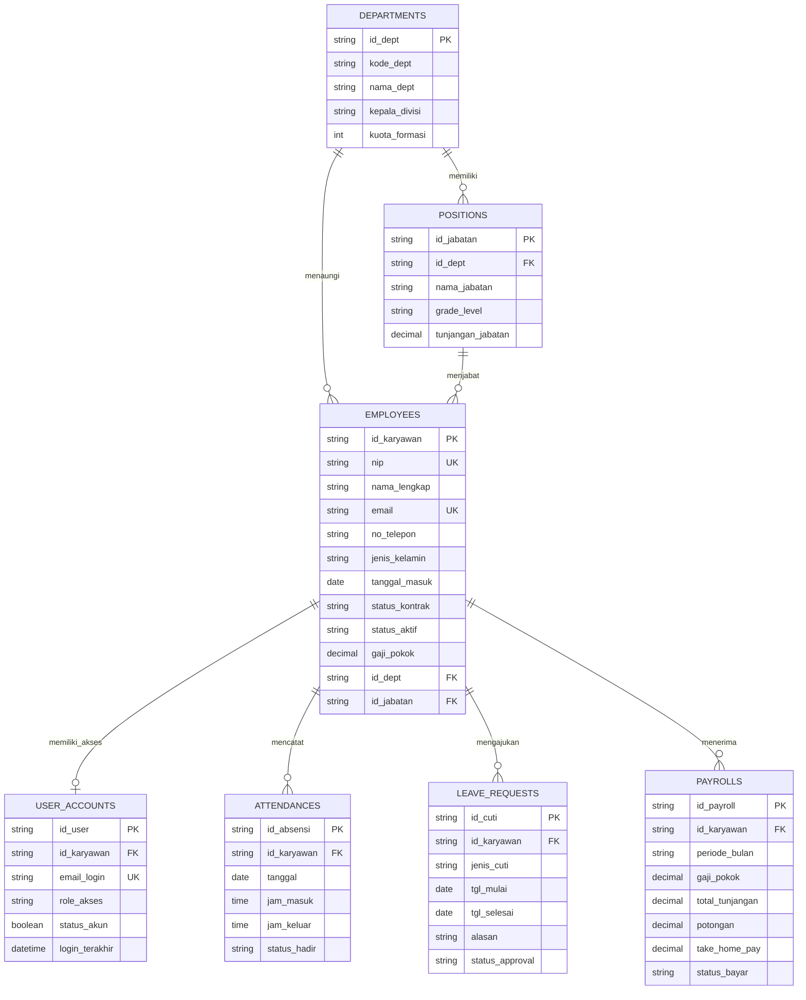
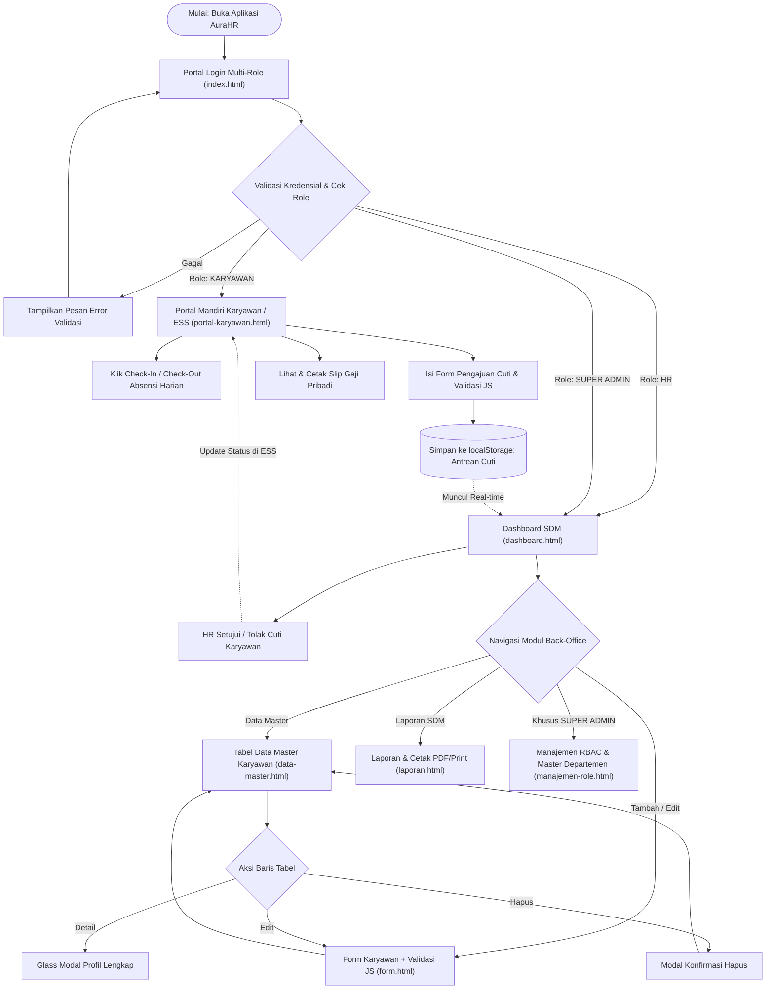
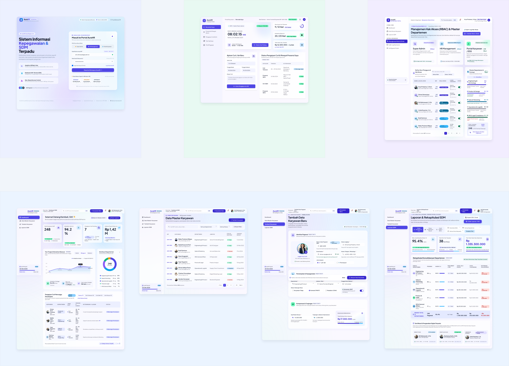
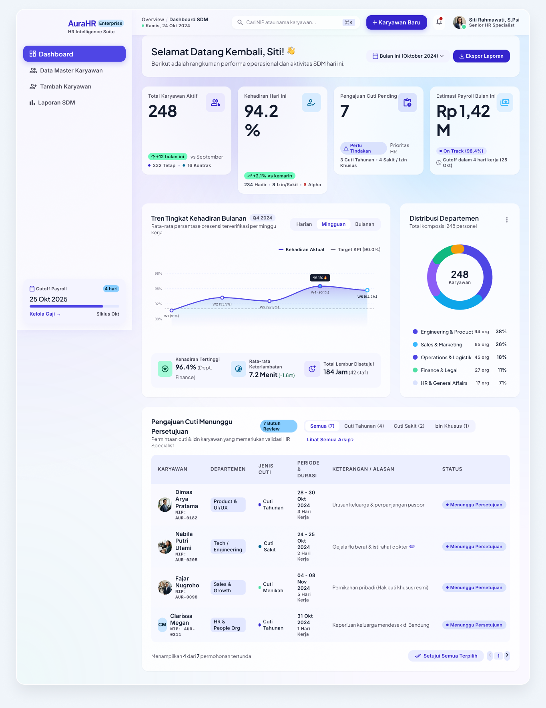
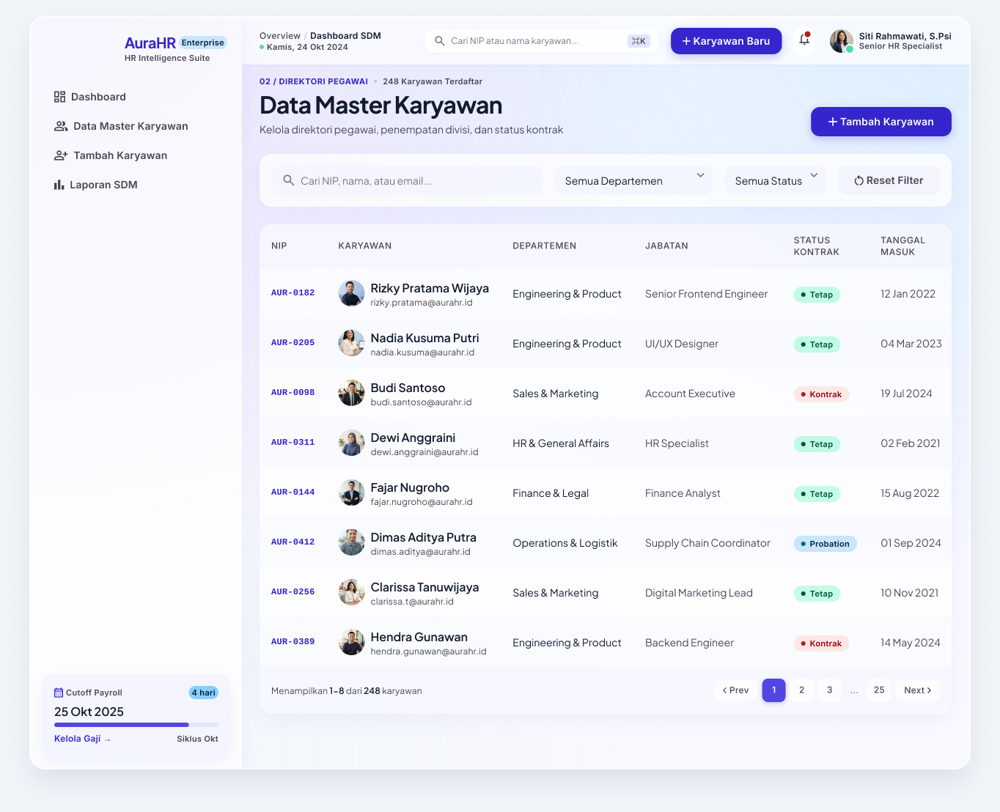

# Dokumentasi Perancangan Antarmuka (UI/UX) & Arsitektur Sistem
## Sistem Informasi Kepegawaian & SDM Terpadu — **AuraHR (Multi-Role HRMS)**

- **Mata Kuliah:** Pemrograman Web 2 (Client-Side Programming)
- **Topik Sistem:** #7 Aplikasi Kepegawaian & SDM (*Human Resource Management System* / HRMS)
- **Arsitektur Pengguna:** **Multi-Role RBAC Client-Side** (*Super Admin*, *HR Management*, & *Portal Mandiri Karyawan / ESS*)
- **Konsep Visual & Arsitektur UI:** **Modern Enterprise Light Glassmorphism**
- **Teknologi Client-Side:** HTML5 Semantik, CSS3 Modern (*Custom Properties*, Flexbox, CSS Grid, `backdrop-filter`, `@media print`), Vanilla JavaScript (ES6+), Chart.js v4, & `localStorage` Persistence
- **Repository GitHub:** https://github.com/nandangadriansyah18/aurahr-hrms-admin
- **Live Demo (GitHub Pages):** https://nandangadriansyah18.github.io/aurahr-hrms-admin/

---

## 1. Analisis Karakteristik Sistem & UX HRMS

Sebagai ekosistem *Human Resource Management System* (HRMS) yang utuh, **AuraHR** tidak hanya memfasilitasi pengelolaan administrasi sepihak, melainkan mempertemukan **3 peran utama organisasi** (*Super Admin*, *HR Specialist/Manager*, dan *Karyawan*) dalam satu alur data yang saling terhubung:

1. **Keterbacaan Data Tinggi (*High Data Legibility*):** Staf HR dan Super Admin memindai ratusan baris NIP, nama pegawai, departemen, hak akses role, status kontrak, dan nominal *payroll*. Efek *Glassmorphism* diterapkan secara presisi (*high-contrast frosted glass*) di atas tipografi gelap yang tajam agar mata tidak cepat lelah.
2. **Integrasi Dua Arah HR ↔ Karyawan (*Connected Employee Self-Service*):** Karyawan dapat melakukan *Check-In/Check-Out* absensi harian, mengunduh slip gaji, serta mengajukan cuti melalui **Portal Karyawan (ESS)**—yang secara otomatis muncul *real-time* di antrean *Approval* pada **Dashboard HR**.
3. **Tata Kelola Akses Berjenjang (*Role-Based Access Control / RBAC*):** **Super Admin** memiliki kontrol khusus terhadap akun pengguna, penetapan role (`Super Admin`, `HR`, `Karyawan`), reset kata sandi, serta formasi kuota tiap departemen yang tidak dapat diubah sembarangan oleh pengguna biasa.
4. **Pencarian Instan & Pencegahan Kesalahan Input:** Direktori pegawai dilengkapi *live search* & filter multi-kriteria tanpa *reload* halaman, sedangkan form manipulasi data dilindungi *Validasi JavaScript Real-time* dan *Modal Konfirmasi Hapus*.

---

## 2. Arsitektur Visual & Design System Awal (Glassmorphism)

Untuk menghindari kelemahan klasik *Glassmorphism* (kontras rendah), **AuraHR** menggunakan pendekatan **Light Frosted Glassmorphism** di atas latar *Soft Aurora Mesh Gradient*.

### 2.1 Palet Warna (*Color Tokens*)

| Kategori | Nama Token | Kode HEX / Nilai RGBA | Penggunaan Utama |
| :--- | :--- | :--- | :--- |
| **Brand Primary** | `--color-primary` | `#4F46E5` (Indigo 600) | Tombol aksi utama, menu sidebar aktif, fokus input, aksen role HR |
| **Brand Hover** | `--color-primary-hover` | `#4338CA` (Indigo 700) | State *hover* & *active* pada tombol utama |
| **Brand Accent** | `--color-accent` | `#0EA5E9` (Sky 500) | Aksen sekunder, grafik seri ke-2, *gradient* ikon & indikator info |
| **Role Admin Accent** | `--color-violet` | `#8B5CF6` (Violet 500) | Identitas badge *Super Admin* & *ambient mesh orb* |
| **Canvas Base** | `--bg-canvas` | `#EEF2FF` → `#E0F2FE` | *Soft Mesh Gradient* latar belakang utama agar efek kaca tampak hidup |
| **Glass Surface 1** | `--glass-bg` | `rgba(255, 255, 255, 0.70)` | Kontainer utama (Sidebar, KPI Card, Pembungkus Tabel, Form Card) |
| **Glass Surface 2** | `--glass-bg-elevated` | `rgba(255, 255, 255, 0.86)` | Topbar *sticky*, Dropdown, Modal Dialog, dan area baca tabel padat |
| **Glass Border** | `--glass-border` | `rgba(255, 255, 255, 0.65)` | Garis tepi kristal `1px solid` pencipta efek kilau tepi kaca |
| **Text Primary** | `--text-primary` | `#0F172A` (Slate 900) | Judul halaman, nama pegawai, angka metrik KPI (Kontras tinggi WCAG AAA) |
| **Text Secondary** | `--text-secondary` | `#475569` (Slate 600) | Label form, sub-judul, teks tabel sekunder, navigasi non-aktif |
| **Text Muted** | `--text-muted` | `#94A3B8` (Slate 400) | *Placeholder* input, teks *caption*, *timestamp* |
| **Status Success** | `--status-success` | `#10B981` (Emerald 500) | Badge *Aktif*, *Hadir*, *Disetujui HR*, identitas role *Karyawan* |
| **Status Warning** | `--status-warning` | `#F59E0B` (Amber 500) | Badge *Probation/Kontrak*, *Menunggu Approval HR*, *Terlambat* |
| **Status Danger** | `--status-danger` | `#EF4444` (Rose/Red 500) | Badge *Nonaktif/Resign*, *Ditolak/Alpha*, tombol Hapus, error validasi |

### 2.2 Parameter Efek Kaca (*Glassmorphism Specs*)

- **Backdrop Blur Standar:** `backdrop-filter: blur(16px) saturate(180%);`
- **Backdrop Blur Modal/Overlay:** `backdrop-filter: blur(24px) saturate(190%);`
- **Ambient Box Shadow:** `0 8px 32px 0 rgba(31, 38, 135, 0.08)`
- **Border Radius:** `10px–12px` (Input/Button/Badge), `18px` (Card/Panel/Table), `24px` (Modal/Login Card).

### 2.3 Tipografi (*Typography Scale*)

- **Primary Font Family:** `'Plus Jakarta Sans', sans-serif` — modern, bersih, dan sangat jelas pada ukuran antarmuka padat data.
- **Monospace Font Family:** `'JetBrains Mono', monospace` — khusus untuk kode **NIP**, **Nominal Rupiah**, dan **Jam Presensi Live** agar rata vertikal (*tabular figures*).

| Style | Ukuran (`rem`/`px`) | Ketebalan (*Weight*) | Line Height | Penggunaan |
| :--- | :--- | :--- | :--- | :--- |
| **Display / KPI Metric** | `1.75rem` (`28px`) | `700` (Bold) | `1.2` | Angka utama pada KPI Card Dashboard & Jam Digital ESS |
| **Heading 1 (Page Title)** | `1.5rem` (`24px`) | `700` (Bold) | `1.3` | Judul utama setiap halaman |
| **Heading 2 (Section)** | `1.125rem` (`18px`) | `600` (SemiBold) | `1.4` | Judul panel grafik, kartu tabel, dan grup seksi form |
| **Body Regular** | `0.875rem` (`14px`) | `400` / `500` | `1.5` | Isi sel tabel, input form, menu navigasi |
| **Caption / Badge** | `0.75rem` (`12px`) | `600` (SemiBold) | `1.4` | Status badge, label kolom tabel (*uppercase*), pesan error |

---

## 3. Arsitektur Multi-Role (RBAC) & Hirarki Menu

**AuraHR** menerapkan simulasi **Role-Based Access Control (RBAC)** di sisi klien dengan **3 aktor pengguna** yang datanya saling tersinkronisasi melalui `localStorage`:

| Role Aktor | Fokus Tanggung Jawab | Hak Akses Modul |
| :--- | :--- | :--- |
| **1. Super Admin (`SUPER_ADMIN`)** | Pengelola sistem, keamanan akun, hak akses role, & master departemen | Seluruh modul HR **+** halaman khusus **Manajemen Hak Akses (RBAC) & Master Departemen** |
| **2. HR Management (`HR`)** | Pengelola operasional SDM harian, direktori pegawai, approval cuti, & laporan payroll | **Dashboard SDM**, **Data Master Karyawan** (CRUD), **Form Karyawan**, **Approval Cuti**, & **Laporan SDM** |
| **3. Karyawan (`KARYAWAN` / ESS)** | *Employee Self-Service* (mandiri): presensi harian, pengajuan cuti, & lihat slip gaji | **Portal Mandiri Karyawan (ESS)**: Check-In/Out Absensi, Form Ajukan Cuti *(masuk ke Dashboard HR)*, & Slip Gaji |

### 3.1 Pohon Hirarki Antarmuka Lengkap

```text
AuraHR Integrated HRMS (Multi-Role Web Application)
├── Autentikasi Multi-Role (index.html)
│   ├── Tab Pemilih Role (Super Admin | HR Management | Portal Karyawan)
│   ├── Form Login Email/NIP & Password + Validasi JS
│   └── Akun Demo Cepat 1-Klik Auto-Fill untuk Pengujian Lintas Role
│
├── Workspace Back-Office HR & Super Admin (Master Layout: layout.html)
│   ├── Topbar Header (Sticky Glass)
│   │   ├── Toggle Sidebar, Breadcrumb Dinamis & Badge Role Aktif
│   │   ├── Global Quick Search (Cari cepat NIP / Nama Pegawai)
│   │   └── Notifikasi Pengajuan Cuti Masuk, Quick Switch Role & Logout
│   │
│   ├── Sidebar Navigasi Adaptif (Menyesuaikan Role Login)
│   │   ├── [UTAMA — HR & SUPER ADMIN]
│   │   │   └── Dashboard Analitik SDM (pages/dashboard.html)
│   │   ├── [KEPEGAWAIAN — HR & SUPER ADMIN]
│   │   │   ├── Data Master Karyawan (pages/data-master.html)
│   │   │   └── Form Tambah / Edit Karyawan (pages/form.html)
│   │   ├── [OPERASIONAL & LAPORAN — HR & SUPER ADMIN]
│   │   │   └── Laporan Kehadiran & Rekapitulasi Payroll (pages/laporan.html)
│   │   └── [SISTEM & ORGANISASI — KHUSUS SUPER ADMIN]
│   │       └── Manajemen Hak Akses (RBAC) & Master Departemen (pages/manajemen-role.html)
│
└── Workspace Portal Mandiri Karyawan / ESS (pages/portal-karyawan.html)
    ├── Sidebar Khusus Karyawan (Beranda Saya, Presensi, Pengajuan Cuti, Slip Gaji)
    ├── Kartu Presensi Harian Live (Jam Digital WIB + Check-In / Check-Out)
    ├── 3 KPI Pribadi (Sisa Kuota Cuti, Kehadiran Bulan Ini, Take Home Pay & Unduh Slip)
    ├── Form Interaktif Ajukan Cuti / Izin Baru (Tersinkron ke Antrean HR)
    └── Tabel Status Pengajuan Cuti & Riwayat Presensi Pribadi
```

### 3.2 Spesifikasi Modul Halaman Lengkap (8 File HTML)

| No | Nama Halaman | File Target | Role Akses | Komponen & Fitur Utama |
| :--- | :--- | :--- | :--- | :--- |
| 1 | **Portal Login Multi-Role** | `index.html` | Semua Role | Split-screen *frosted glass*, tab pemilih role, validasi kredensial ketat (Email/NIP + Password), akses cepat akun demo, & pengalihan rute otomatis sesuai role. |
| 2 | **Template Dasar Workspace** | `layout.html` | Referensi M2 | Kerangka dasar *reusable* berisi Sidebar responsif (*collapsible* & *mobile drawer*), Sticky Header, *Main Content Area*, dan Footer. |
| 3 | **Dashboard SDM** | `pages/dashboard.html` | Admin & HR | 4 KPI Cards SDM dinamis, Grafik *Tren Kehadiran Bulanan* & *Distribusi Departemen* (Chart.js), tabel *Approval Cuti* interaktif, & **Log Presensi Masuk/Keluar Karyawan**. |
| 4 | **Data Master Karyawan** | `pages/data-master.html` | Admin & HR | Live Search, Filter Departemen & Status Kontrak, **Export CSV**, Tabel Direktori Pegawai lengkap, Glass Modal Detail Profil, Modal Konfirmasi Hapus, aksi Tambah/Edit. |
| 5 | **Form Karyawan** | `pages/form.html` | Admin & HR | Mode ganda (*Tambah* & *Edit*), 3 seksi form (Identitas, Penempatan, Kompensasi + kalkulasi otomatis *Take Home Pay*), validasi JS real-time, & *auto-create* akun ESS. |
| 6 | **Laporan & Rekap SDM** | `pages/laporan.html` | Admin & HR | Tab *Rekap Departemen* & *Rincian Slip Per Pegawai*, filter periode & departemen, **Export CSV** dinamis, blok pengesahan digital, & cetak **A4 Landscape (`window.print()`)**. |
| 7 | **Portal Karyawan (ESS)** | `pages/portal-karyawan.html` | Karyawan | Menu terpisah *Beranda & Presensi* (Jam WIB *live*, Check-In/Out, KPI kehadiran dinamis, riwayat presensi), *Pengajuan Cuti & Izin* (terhubung ke Dashboard HR), & *Slip Gaji Digital* siap cetak. |
| 8 | **Manajemen Role & Divisi** | `pages/manajemen-role.html` | Super Admin | 3 kartu ringkasan RBAC, tabel *Daftar Akun Pengguna* (ubah role, toggle aktif/nonaktif, **Reset Sandi**, **Hapus Akun**), & panel *Master Departemen* (tambah/hapus divisi & edit kuota). |

---

## 4. Konsep Entity-Relationship Diagram (ERD)

Struktur data JSON di `localStorage` dirancang mengikuti model basis data relasional ternormalisasi yang mencakup manajemen akun *multi-role* (`USER_ACCOUNTS`), kepegawaian, struktur organisasi, presensi, cuti, dan *payroll*:



---

## 5. User Flow Multi-Role (Super Admin, HR, & Karyawan)

Diagram berikut memperlihatkan bagaimana alur interaksi ke-3 role saling terhubung di dalam aplikasi:



---

## 6. Skema Komponen Polimorfik & Reusable UI

Agar rancangan di **Google Stitch**, komponen **Figma**, dan kode **CSS** seragam di seluruh 7 layar lintas role, komponen utama disusun secara polimorfik menggunakan *base class* dan *modifier variants*:

1. **`GlassCard` (Container Polimorfik)**
   - `glass-card--stat`: Kartu metrik KPI (baik KPI organisasi HR maupun KPI personal Karyawan ESS).
   - `glass-card--panel`: Kartu pembungkus grafik Chart.js, form grup, kartu presensi live, dan tabel.
   - `glass-card--interactive`: Efek angkat halus `translateY(-3px)` & kilau border saat di-*hover*.
2. **`Btn` (Tombol Aksi)**
   - `btn--primary`: Indigo `#4F46E5` untuk CTA utama (*Masuk*, *+ Tambah Karyawan*, *Simpan*, *Check-In/Out*, *Cetak Laporan*).
   - `btn--glass`: Tombol kaca transparan untuk aksi sekunder (*Filter*, *Batal*, *Export CSV*).
   - `btn--danger`: Aksen merah untuk penolakan cuti atau konfirmasi penghapusan data.
   - `btn--icon`: Tombol persegi kompak untuk aksi baris tabel (*Detail*, *Edit*, *Hapus*).
3. **`Badge` (Indikator Status & Role RBAC)**
   - **Status Kepegawaian/Cuti:** `badge--active` (Emerald), `badge--warning` (Amber), `badge--danger` (Rose), `badge--info` (Sky).
   - **Identitas Role:** `badge--role-admin` (Violet `#8B5CF6`), `badge--role-hr` (Indigo `#4F46E5`), `badge--role-ess` (Emerald `#10B981`).
4. **`FormControl` (Input & Validasi Real-time)**
   - Latar `rgba(255, 255, 255, 0.75)`, state `:focus` bercincin Indigo, serta state `.is-invalid` untuk menampilkan pesan kesalahan spesifik tepat di bawah field.

---

## 7. Tautan & Dokumentasi Visual (Google Stitch & Figma)

### 7.1 Tautan Proyek Desain Publik
- **Link Publik Project Figma (Utama — Multi-Role HRMS UI):** https://www.figma.com/design/ngTkoDdRVBud5g1gNqT7WU/AuraHR---Multi-Role-HRMS-Admin-Panel?node-id=1-2
- **Link Publik Halaman Design System Figma (`01 - Design System`):** https://www.figma.com/design/ngTkoDdRVBud5g1gNqT7WU/AuraHR---Multi-Role-HRMS-Admin-Panel?node-id=0-1
- **Link Project Google Stitch (7 Layar Multi-Role):** https://stitch.google.com/projects/9802515967131939644

### 7.2 Ringkasan Eksplorasi Wireframe 7 Layar (Google Stitch)
Seluruh 7 layar Multi-Role telah dibuat di Google Stitch ([Lihat Project Stitch](https://stitch.google.com/projects/9802515967131939644)) dan diekspor ke Figma:
1. Portal Login Multi-Role (`index.html`)
2. Dashboard Analitik SDM (`pages/dashboard.html`)
3. Data Master Karyawan (`pages/data-master.html`)
4. Form Tambah / Edit Karyawan (`pages/form.html`)
5. Laporan Kehadiran & Rekapitulasi Payroll (`pages/laporan.html`)
6. Portal Mandiri Karyawan / ESS (`pages/portal-karyawan.html`)
7. Manajemen Hak Akses RBAC & Master Departemen (`pages/manajemen-role.html`)

---

### 7.3 Design System & High-Fidelity UI Architecture (Figma)

#### Halaman `02 - Multi-Role HRMS UI` (Arsitektur Terstruktur 4 Zona Role & 7 Layar Editable Auto-Layout)


#### High-Fidelity UI — Halaman Dashboard Analitik SDM (`pages/dashboard.html`)


#### High-Fidelity UI — Halaman Data Master Karyawan (`pages/data-master.html`)


---

## 8. Arsitektur Penyimpanan Data Client-Side (`localStorage`)

Sesuai ketentuan tugas *Client-Side Programming*, seluruh persistensi data berjalan di sisi browser tanpa *back-end* server melalui modul `assets/js/store.js` (`AuraStore`):

1. **Key Penyimpanan:**
   - `aurahr_hrms_db_v1` — Menyimpan 5 koleksi data terstruktur (`departments`, `employees`, `leaveRequests`, `essAttendances`, `accounts`).
   - `aurahr_active_session_v1` — Menyimpan sesi pengguna yang sedang login beserta hak akses *role*-nya (`SUPER_ADMIN`, `HR`, atau `KARYAWAN`).
2. **Alur Sinkronisasi Lintas Role:**
   - Karyawan melakukan **Check-In / Check-Out** atau **Ajukan Cuti** di `portal-karyawan.html` → tersimpan ke `localStorage` → langsung terbaca di **Dashboard HR** (`dashboard.html`) untuk dipantau & disetujui/ditolak.
   - HR menambah pegawai baru di `form.html` → sistem otomatis membuatkan akun login Portal Karyawan di tabel `accounts`.
   - Super Admin menambah departemen atau mengubah role/sandi di `manajemen-role.html` → langsung berlaku di proses login (`index.html`) dan pilihan departemen di seluruh halaman.
